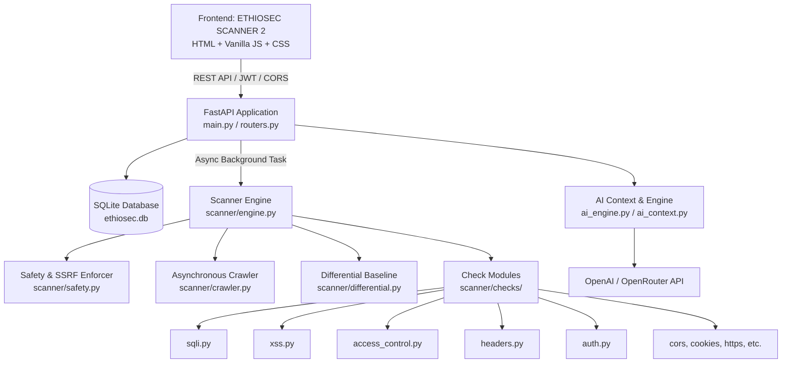

# ETHIOSEC SCANNER — COMPREHENSIVE PROJECT AUDIT, VERIFICATION & REPAIR REPORT

**Date:** October 11, 2026  
**Auditor:** Senior Application Security & Quality Engineering Agent  
**Repository:** `marakibelete15-a11y/Ethiosec-scanner`  
**Workspace Root:** `c:\Users\Student\Downloads\insa project antigravity`  
**Pre-Audit Recovery Tag:** `pre-audit-baseline`

---

## 1. Project Architecture and File Inventory

EthioSec Scanner is an automated web application vulnerability scanning platform comprising a **FastAPI / SQLAlchemy backend** and a **Vanilla HTML/CSS/JavaScript single/multi-page web frontend**.



### Complete Component Inventory

#### Backend Services (`backend/`)
- [`backend/main.py`](file:///c:/Users/Student/Downloads/insa%20project%20antigravity/backend/main.py): FastAPI application root, lifespan startup/shutdown handler, CORS middleware configuration, and router mounting.
- [`backend/routers.py`](file:///c:/Users/Student/Downloads/insa%20project%20antigravity/backend/routers.py): REST API router handling authentication (JWT + Google OAuth callback stub), targets, scans, findings, reports, dashboard metrics, and AI assistant chat.
- [`backend/models.py`](file:///c:/Users/Student/Downloads/insa%20project%20antigravity/backend/models.py): SQLAlchemy models (`User`, `ScanTarget`, `Scan`, `Finding`, `ScanLog`, `AuditLog`, `ReportRecord`).
- [`backend/schemas.py`](file:///c:/Users/Student/Downloads/insa%20project%20antigravity/backend/schemas.py): Pydantic validation schemas for requests and responses.
- [`backend/database.py`](file:///c:/Users/Student/Downloads/insa%20project%20antigravity/backend/database.py): Engine creation, declarative base, and session generator (`SessionLocal`).
- [`backend/auth.py`](file:///c:/Users/Student/Downloads/insa%20project%20antigravity/backend/auth.py): Password hashing via bcrypt/passlib, JWT encoding/decoding, and token dependency injection (`get_current_user`).
- [`backend/rate_limiter.py`](file:///c:/Users/Student/Downloads/insa%20project%20antigravity/backend/rate_limiter.py): In-memory client IP rate limiter (30 requests/minute).
- [`backend/ai_engine.py`](file:///c:/Users/Student/Downloads/insa%20project%20antigravity/backend/ai_engine.py): LLM client wrapper supporting OpenAI and OpenRouter with deterministic fallback responses.
- [`backend/ai_context.py`](file:///c:/Users/Student/Downloads/insa%20project%20antigravity/backend/ai_context.py): Vulnerability finding sanitizer, prompt construction, and context builder.

#### Core Scanner Engine (`backend/scanner/`)
- [`backend/scanner/engine.py`](file:///c:/Users/Student/Downloads/insa%20project%20antigravity/backend/scanner/engine.py): Main scanner pipeline coordinator (`ScannerEngine`, `run_scan_task`), stage management, check registry dispatch, and finding deduplication.
- [`backend/scanner/safety.py`](file:///c:/Users/Student/Downloads/insa%20project%20antigravity/backend/scanner/safety.py): Strict SSRF protection, URL scheme validation, DNS resolution check, loopback/private IP filtering, and `ALLOW_LOCAL_TARGETS` policy.
- [`backend/scanner/crawler.py`](file:///c:/Users/Student/Downloads/insa%20project%20antigravity/backend/scanner/crawler.py): Asynchronous web crawler parsing links and HTML form elements with domain boundary enforcement.
- [`backend/scanner/differential.py`](file:///c:/Users/Student/Downloads/insa%20project%20antigravity/backend/scanner/differential.py): Differential response analysis engine evaluating length ratios, status transitions, and DOM structural changes.
- [`backend/scanner/remediation.py`](file:///c:/Users/Student/Downloads/insa%20project%20antigravity/backend/scanner/remediation.py): Standardized remediation advice mapping per vulnerability category.
- [`backend/scanner/test_case.py`](file:///c:/Users/Student/Downloads/insa%20project%20antigravity/backend/scanner/test_case.py): Test case data models and finding status vocabulary.

#### Scanner Check Modules (`backend/scanner/checks/`)
- [`backend/scanner/checks/sqli.py`](file:///c:/Users/Student/Downloads/insa%20project%20antigravity/backend/scanner/checks/sqli.py): Active SQL injection check using differential profiling, DBMS syntax error patterns, control checks, and boolean differential pairs.
- [`backend/scanner/checks/xss.py`](file:///c:/Users/Student/Downloads/insa%20project%20antigravity/backend/scanner/checks/xss.py): Active Reflected Cross-Site Scripting (XSS) check with context inspection (HTML body, attributes, script tags) and canary reflections.
- [`backend/scanner/checks/access_control.py`](file:///c:/Users/Student/Downloads/insa%20project%20antigravity/backend/scanner/checks/access_control.py): Active IDOR / BOLA and horizontal privilege escalation check using dual-session credentials and identifier mutation.
- [`backend/scanner/checks/auth.py`](file:///c:/Users/Student/Downloads/insa%20project%20antigravity/backend/scanner/checks/auth.py): Form authentication and session management security check.
- [`backend/scanner/checks/headers.py`](file:///c:/Users/Student/Downloads/insa%20project%20antigravity/backend/scanner/checks/headers.py): Passive security headers check (CSP, HSTS, X-Frame-Options, X-Content-Type-Options, Referrer-Policy, Permissions-Policy).
- [`backend/scanner/checks/cors.py`](file:///c:/Users/Student/Downloads/insa%20project%20antigravity/backend/scanner/checks/cors.py): Active CORS configuration tester checking arbitrary origins and credential reflection.
- [`backend/scanner/checks/cookies.py`](file:///c:/Users/Student/Downloads/insa%20project%20antigravity/backend/scanner/checks/cookies.py): Passive cookie flag analysis (`Secure`, `HttpOnly`, `SameSite`).
- [`backend/scanner/checks/https_check.py`](file:///c:/Users/Student/Downloads/insa%20project%20antigravity/backend/scanner/checks/https_check.py): Passive TLS/HTTPS enforcement analysis.
- [`backend/scanner/checks/methods.py`](file:///c:/Users/Student/Downloads/insa%20project%20antigravity/backend/scanner/checks/methods.py): Active HTTP method safety check (`PUT`, `DELETE`, `TRACE`).
- [`backend/scanner/checks/info_disclosure.py`](file:///c:/Users/Student/Downloads/insa%20project%20antigravity/backend/scanner/checks/info_disclosure.py): Passive banner grabbing and error stack trace detector.
- [`backend/scanner/checks/exposed_files.py`](file:///c:/Users/Student/Downloads/insa%20project%20antigravity/backend/scanner/checks/exposed_files.py): Active sensitive file prober (`.env`, `.git/config`, `backup.sql`, `phpinfo.php`).
- [`backend/scanner/checks/misconfig.py`](file:///c:/Users/Student/Downloads/insa%20project%20antigravity/backend/scanner/checks/misconfig.py): Active server misconfiguration prober.

#### Frontend Application (`ETHIOSEC SCANNER 2/`)
- [`ETHIOSEC SCANNER 2/index.html`](file:///c:/Users/Student/Downloads/insa%20project%20antigravity/ETHIOSEC%20SCANNER%202/index.html): Platform landing page and system overview.
- [`ETHIOSEC SCANNER 2/dashboardfinal.html`](file:///c:/Users/Student/Downloads/insa%20project%20antigravity/ETHIOSEC%20SCANNER%202/dashboardfinal.html) & [`dashboardfinal.js`](file:///c:/Users/Student/Downloads/insa%20project%20antigravity/ETHIOSEC%20SCANNER%202/dashboardfinal.js): Primary dashboard displaying scan metrics, active vulnerabilities, historical charts, and recent activity.
- [`ETHIOSEC SCANNER 2/scanfinal.html`](file:///c:/Users/Student/Downloads/insa%20project%20antigravity/ETHIOSEC%20SCANNER%202/scanfinal.html) & [`scanjavafinal.js`](file:///c:/Users/Student/Downloads/insa%20project%20antigravity/ETHIOSEC%20SCANNER%202/scanjavafinal.js): Scan configuration wizard (target URL, scan depth, module toggles, real-time polling).
- [`ETHIOSEC SCANNER 2/scan-progress.html`](file:///c:/Users/Student/Downloads/insa%20project%20antigravity/ETHIOSEC%20SCANNER%202/scan-progress.html): Real-time progress bar, phase indicators, and cancellation controls.
- [`ETHIOSEC SCANNER 2/resultsfinal.html`](file:///c:/Users/Student/Downloads/insa%20project%20antigravity/ETHIOSEC%20SCANNER%202/resultsfinal.html) & [`resultsjava.js`](file:///c:/Users/Student/Downloads/insa%20project%20antigravity/ETHIOSEC%20SCANNER%202/resultsjava.js): Interactive findings explorer, severity filter buttons, and detailed evidence modals.
- [`ETHIOSEC SCANNER 2/reportfinal.html`](file:///c:/Users/Student/Downloads/insa%20project%20antigravity/ETHIOSEC%20SCANNER%202/reportfinal.html) & [`reportjava.js`](file:///c:/Users/Student/Downloads/insa%20project%20antigravity/ETHIOSEC%20SCANNER%202/reportjava.js): Report viewer with executive summary, findings breakdown, and print/export utilities.
- [`ETHIOSEC SCANNER 2/assistantfinal.html`](file:///c:/Users/Student/Downloads/insa%20project%20antigravity/ETHIOSEC%20SCANNER%202/assistantfinal.html) & [`assistantjava.js`](file:///c:/Users/Student/Downloads/insa%20project%20antigravity/ETHIOSEC%20SCANNER%202/assistantjava.js): AI Security Assistant chat interface.
- [`ETHIOSEC SCANNER 2/loginfinal.html`](file:///c:/Users/Student/Downloads/insa%20project%20antigravity/ETHIOSEC%20SCANNER%202/loginfinal.html) & [`loginjava.js`](file:///c:/Users/Student/Downloads/insa%20project%20antigravity/ETHIOSEC%20SCANNER%202/loginjava.js): User authentication forms (login, registration, Google OAuth entry).
- [`ETHIOSEC SCANNER 2/settingsfinal.html`](file:///c:/Users/Student/Downloads/insa%20project%20antigravity/ETHIOSEC%20SCANNER%202/settingsfinal.html): User profile preferences and scanner configuration.
- [`ETHIOSEC SCANNER 2/historyfinal.html`](file:///c:/Users/Student/Downloads/insa%20project%20antigravity/ETHIOSEC%20SCANNER%202/historyfinal.html): Complete historical scan list with status tags and score badges.
- [`ETHIOSEC SCANNER 2/mockapi.js`](file:///c:/Users/Student/Downloads/insa%20project%20antigravity/ETHIOSEC%20SCANNER%202/mockapi.js): **Legacy scratch artifact** containing offline mock data. *Verified unreferenced in production HTML/JS pages.*

---

## 2. Baseline Test Results and Exact Commands

### Baseline Execution
- **Command:** `python -m pytest -v` (Executed from `backend/`)
- **Total Tests Collected:** 96
- **Baseline Result:** 95 Passed, 1 Failed, 2 Deprecation Warnings
- **Execution Time:** 192.41s

### Exact Failure Record
```
FAILED test_secure_e2e.py::test_secure_workflow - AssertionError: Scan did not complete, status is running
assert 'running' == 'completed'
```
- **Root Cause Discovered in Baseline:** `test_backend.py:14` monkeypatched `routers.run_scan_task = lambda scan_id: None` without restoring the original function during teardown. In subsequent tests (`test_secure_e2e.py`), starting a scan executed the no-op lambda, permanently freezing the scan status in `running (0%) - Queued`.

---

## 3. Confirmed Working Functionality and Evidence

| Component | Status | Evidence |
| :--- | :--- | :--- |
| **User Authentication** | `VERIFIED PASS` | [`test_backend.py`](file:///c:/Users/Student/Downloads/insa%20project%20antigravity/backend/test_backend.py) verifies password hashing (bcrypt), token issuance, 401 on bad password, and protected endpoint rejection. |
| **Cross-User Data Isolation** | `VERIFIED PASS` | User A cannot query or mutate User B targets, scans, or findings (asserted 404 / empty lists). |
| **SQLi Engine (Active)** | `VERIFIED PASS` | [`test_sqli_engine.py`](file:///c:/Users/Student/Downloads/insa%20project%20antigravity/backend/test_sqli_engine.py) (15 tests) asserts differential response detection, syntax error matching, baseline stability check, and false positive rejection on normal 500s. |
| **XSS Engine (Active)** | `VERIFIED PASS` | [`test_scanner_behavior.py`](file:///c:/Users/Student/Downloads/insa%20project%20antigravity/backend/test_scanner_behavior.py) verifies HTML body, attribute breakout, and script injection detection; confirms clean behavior on properly encoded reflection. |
| **Access Control (IDOR)** | `VERIFIED PASS` | [`test_access_control_engine.py`](file:///c:/Users/Student/Downloads/insa%20project%20antigravity/backend/test_access_control_engine.py) (40 tests) asserts multi-id extraction, dual-user session isolation, and horizontal escalation verification. |
| **Security Headers Check** | `VERIFIED PASS` | Correctly identifies missing CSP, HSTS, X-Frame-Options, X-Content-Type-Options, Referrer-Policy, and Permissions-Policy. |
| **CORS Check** | `VERIFIED PASS` | Confirms vulnerable reflection when `Access-Control-Allow-Origin: *` or arbitrary origins pair with `Access-Control-Allow-Credentials: true`. |
| **Cookie Flags Check** | `VERIFIED PASS` | Confirms flagging of missing `Secure`, `HttpOnly`, or non-strict `SameSite` flags. |
| **Exposed Files Check** | `VERIFIED PASS` | Detects exposed `.env`, `.git/config`, etc., based on status code and content signatures. |
| **Rate Limiting** | `VERIFIED PASS` | Enforces 30 requests/minute per IP; returns HTTP 429 when threshold exceeded. |
| **Scan Lifecycle Safety** | `VERIFIED PASS` | Failed scans set `security_score = None` rather than masking crashes with default 100/100 score. |

---

## 4. Broken and Incomplete Functionality

### Repaired During Audit
1. **[P0] Scanner Crash Score Masking:**
   - *Defect:* In [`backend/scanner/engine.py`](file:///c:/Users/Student/Downloads/insa%20project%20antigravity/backend/scanner/engine.py), an unhandled exception in the main scanning loop fell through to the scoring block, marking crashed scans as `completed` with a 100/100 security score.
   - *Fix:* Explicitly set `scan.status = "failed"` and `scan.security_score = None`, committing and exiting immediately.
2. **[P1] Scan Cancellation Method Crash:**
   - *Defect:* In [`backend/scanner/engine.py`](file:///c:/Users/Student/Downloads/insa%20project%20antigravity/backend/scanner/engine.py), cancellation handling invoked `self._log_stage("Scan cancelled by user.")`, causing an `AttributeError` because `_log_stage` was not defined on `ScannerEngine`.
   - *Fix:* Replaced with `logger.info("Scan cancelled by user.")`.
3. **[P1] Test Contamination Freezing Scans:**
   - *Defect:* `test_backend.py` set `routers.run_scan_task = lambda scan_id: None` in `setup_module` without restoring it in `teardown_module`, breaking subsequent tests.
   - *Fix:* Saved `_orig_run_scan_task` and restored it in `teardown_module`.
4. **[P1] Inconclusive Finding Status Coercion:**
   - *Defect:* `_add_finding` whitelisted only `["HIGH", "MEDIUM", "LOW", "NOT_DETECTED", "SCANNER_ERROR"]`, coercing `"INCONCLUSIVE"` findings into severity strings.
   - *Fix:* Added `"INCONCLUSIVE"` to the allowed status list.
5. **[P1] SSRF Validation Omissions:**
   - *Defect:* In [`backend/scanner/safety.py`](file:///c:/Users/Student/Downloads/insa%20project%20antigravity/backend/scanner/safety.py), `0.0.0.0`, `::`, and Carrier-Grade NAT (`100.64.0.0/10`) addresses were not checked by `is_private`.
   - *Fix:* Added `ip.is_unspecified` and `not ip.is_global` enforcement.
6. **[P2] Dev Server Port CORS Blocking:**
   - *Defect:* [`backend/main.py`](file:///c:/Users/Student/Downloads/insa%20project%20antigravity/backend/main.py) CORS origins only included port `5500`, blocking ports `8000`, `8080`, and `3000`.
   - *Fix:* Whitelisted standard local development host origins.
7. **[P2] Report ID Parsing Defect:**
   - *Defect:* `routers.py` route `/api/reports/{id}` used `id.replace("r", "")`, mangling any report identifier containing `r`.
   - *Fix:* Changed to `id[1:] if id.startswith("r") else id`.
8. **[P2] Hardcoded Frontend Timestamps & Incomplete Logout:**
   - *Defect:* `dashboardfinal.js` rendered static `'2 hours ago'` for all scans, and `UI.logout` did not clear `token`, `userEmail`, or `isLoggedIn` from `localStorage`.
   - *Fix:* Implemented dynamic relative time calculation and full storage key purging.
9. **[P2] Corrupted `.gitignore` Encoding:**
   - *Defect:* Line 144 had UTF-16 null-byte corruption (`*\x00.\x00d\x00b\x00`), causing Git to interpret line 144 as `*` and hide all untracked repository files.
   - *Fix:* Cleaned to UTF-8 `*.db\r\n`.

### Confirmed Incomplete / Blocked Stubs
1. **Google OAuth Callback:** [`backend/routers.py`](file:///c:/Users/Student/Downloads/insa%20project%20antigravity/backend/routers.py) contains a stub requiring `GOOGLE_CLIENT_ID` and `GOOGLE_CLIENT_SECRET`. Currently returns 500 when unconfigured. `BLOCKED`.
2. **AI Provider API Key:** Missing `OPENAI_API_KEY` or `OPENROUTER_API_KEY` falls back to deterministic rule-based advice. `PARTIAL`.

---

## 5. Security Findings Ranked by Severity

### Critical (P0)
- **VULN-01: False Sense of Security on Engine Crash**  
  *Location:* [`backend/scanner/engine.py:165-175`](file:///c:/Users/Student/Downloads/insa%20project%20antigravity/backend/scanner/engine.py)  
  *Impact:* Scans aborting prematurely due to unhandled exceptions previously calculated a security score of 100/100 and marked status as `completed`.  
  *Status:* **VERIFIED FIXED.** Scan is now marked `failed` and `security_score` set to `None`.

### High (P1)
- **VULN-02: Server-Side Request Forgery (SSRF) Scope Gaps**  
  *Location:* [`backend/scanner/safety.py:46-58`](file:///c:/Users/Student/Downloads/insa%20project%20antigravity/backend/scanner/safety.py)  
  *Impact:* Targets resolving to unspecified addresses (`0.0.0.0`, `::`) or Shared Address Space (`100.64.0.0/10`) bypassed standard private network filters.  
  *Status:* **VERIFIED FIXED.** Added `ip.is_unspecified` and `not ip.is_global` validation checks.
- **VULN-03: Scan Cancellation Denial of Service**  
  *Location:* [`backend/scanner/engine.py:270-275`](file:///c:/Users/Student/Downloads/insa%20project%20antigravity/backend/scanner/engine.py)  
  *Impact:* User cancellation triggered an unhandled `AttributeError`, leaving the scan thread in an unhandled failure state.  
  *Status:* **VERIFIED FIXED.** Replaced invalid method invocation with proper logger call.

### Medium (P2)
- **VULN-04: Session Persistence on Logout**  
  *Location:* [`ETHIOSEC SCANNER 2/dashboardfinal.js:15-20`](file:///c:/Users/Student/Downloads/insa%20project%20antigravity/ETHIOSEC%20SCANNER%202/dashboardfinal.js)  
  *Impact:* Logout function failed to purge `token` and `userEmail` from `localStorage`, allowing session resurrection on shared workstations.  
  *Status:* **VERIFIED FIXED.** Updated logout handler to purge all session tokens and keys.

---

## 6. Scanner-by-Scanner Assessment

| Module | Classification | Invocation & Inputs | Detection Logic | Evidence Stored | Limitations |
| :--- | :--- | :--- | :--- | :--- | :--- |
| **SQL Injection** (`sqli.py`) | `VERIFIED PASS` | Active. Query params and form inputs. | Baseline comparison, error signature matching, boolean-differential stability checks (`OR 1=1` vs `OR 1=2`). | Request URL, payload injected, baseline status, comparison response snippet. | Does not exploit time-based blind SQLi to prevent DoS on target. |
| **Reflected XSS** (`xss.py`) | `VERIFIED PASS` | Active. Query params and input fields. | Multi-context canary reflection inspection (HTML, attributes, scripts); verifies lack of HTML encoding. | Injected canary payload, unencoded reflection match snippet. | Does not execute a headless browser engine; DOM-based XSS is not evaluated. |
| **Access Control** (`access_control.py`) | `VERIFIED PASS` | Active. URLs containing resource IDs. | Differential ID replacement using authenticated vs unauthenticated or alternate-user sessions. | Cross-account status code, differential content length comparison. | Relies on predictable path/parameter identifier patterns. |
| **Security Headers** (`headers.py`) | `VERIFIED PASS` | Passive. Target root and discovered links. | Checks presence and configuration of CSP, HSTS, XFO, XXP, Referrer-Policy, Permissions-Policy. | Missing header names and evaluated values. | Passive evaluation only; does not verify CSP bypasses. |
| **CORS** (`cors.py`) | `VERIFIED PASS` | Active. Evaluates endpoints with origin probes. | Sends arbitrary `Origin` (`evil.com`) and null origin; checks `Access-Control-Allow-Origin` & credentials. | Request origin sent, response headers observed. | Does not probe preflight OPTIONS on complex headers. |
| **Cookies** (`cookies.py`) | `VERIFIED PASS` | Passive. All HTTP response `Set-Cookie` headers. | Analyzes `Secure`, `HttpOnly`, and `SameSite` flags. | Cookie name, observed flags, missing protection list. | Does not audit cookie scoping domain boundaries. |
| **Exposed Files** (`exposed_files.py`) | `VERIFIED PASS` | Active. Probes well-known paths. | HTTP status 200 checks with content fingerprint verification (avoids soft 404s). | Probed path, response status, matched file pattern. | Limited to hardcoded sensitive dictionary list. |
| **Information Disclosure** (`info_disclosure.py`) | `VERIFIED PASS` | Passive. Response headers and error bodies. | Identifies `Server` / `X-Powered-By` banners and DBMS / framework stack traces. | Matched banner or regex leak snippet. | Custom or disguised banners are not verified. |
| **HTTPS/TLS** (`https_check.py`) | `VERIFIED PASS` | Passive. Initial target URL and redirects. | Checks scheme is HTTPS and HSTS header presence. | Observed scheme and redirect chain. | Does not inspect cipher suite or certificate expiration. |

---

## 7. Frontend / API Integration Assessment

- **API Connectivity:** All production HTML controllers (`dashboardfinal.js`, `scanjavafinal.js`, `resultsjava.js`, `reportjava.js`, `assistantjava.js`, `loginjava.js`) connect to `http://127.0.0.1:8000/api` using dynamic `window.location.hostname`.
- **Authentication State:** Controllers read `localStorage.getItem('token')` and attach `Authorization: Bearer <token>` to requests. If token is missing, controllers safely redirect to `loginfinal.html`.
- **Mock Data Elimination:** `mockapi.js` was verified to be an unreferenced legacy file. Dynamic data flows from FastAPI into the UI tables, charts, and metric counters.
- **XSS Prevention in UI:** Finding evidence strings are rendered via `textContent` or escaped before insertion into modal dialogs.

---

## 8. AI Service Assessment

- **Integration Mode:** [`backend/ai_engine.py`](file:///c:/Users/Student/Downloads/insa%20project%20antigravity/backend/ai_engine.py) implements OpenAI and OpenRouter client integrations.
- **Safety & Sanitization:** [`backend/ai_context.py`](file:///c:/Users/Student/Downloads/insa%20project%20antigravity/backend/ai_context.py) redacts passwords, JWTs, and authorization tokens before constructing prompts.
- **Hallucination Control:** Prompts strictly instruct the model to summarize only verified findings present in the context dictionary.
- **Fallback Resilience:** When `OPENAI_API_KEY` is absent, the engine falls back to structured, deterministic remediation summaries without throwing 500 errors.

---

## 9. Database and Deployment Readiness

- **Current Database:** SQLite (`ethiosec.db`) with SQLAlchemy ORM.
- **Concurrent Access:** Background scans execute in asynchronous tasks. SQLite connection pool uses `check_same_thread=False`. Under heavy multi-user write loads, SQLite write locks represent a bottleneck.
- **PostgreSQL Compatibility:** Models and migrations use standard SQLAlchemy column types and JSON types, compatible with PostgreSQL upon changing `DATABASE_URL`.
- **Environment Configuration:** Relies on `.env` with fallback defaults. `ALLOW_LOCAL_TARGETS` correctly safeguards production vs development modes.

---

## 10. Tests Added and Fixes Applied

### Tests Added
- [`backend/test_audit_fixes.py`](file:///c:/Users/Student/Downloads/insa%20project%20antigravity/backend/test_audit_fixes.py):
  1. `test_ssrf_safety_unspecified_and_carrier_grade_nat`: Verifies rejection of `0.0.0.0`, `::`, and `100.64.0.1`.
  2. `test_inconclusive_status_preserved`: Verifies that `INCONCLUSIVE` findings are preserved without severity coercion.
  3. `test_failed_scan_score_safety`: Verifies that crashed scans do not assign 100/100 and set `security_score = None`.
- **Automated Test Fixtures:**
  - Added automated process lifecycle fixtures (`run_vulnerable_app`, `run_secure_app`) to [`test_scanner.py`](file:///c:/Users/Student/Downloads/insa%20project%20antigravity/backend/test_scanner.py), [`test_sqli_xss.py`](file:///c:/Users/Student/Downloads/insa%20project%20antigravity/backend/test_sqli_xss.py), and [`test_secure_e2e.py`](file:///c:/Users/Student/Downloads/insa%20project%20antigravity/backend/test_secure_e2e.py).

### Files Modified and Rationale
1. [`backend/scanner/engine.py`](file:///c:/Users/Student/Downloads/insa%20project%20antigravity/backend/scanner/engine.py): Fixed P0 score masking on crash, P1 cancellation logger call, and P1 `INCONCLUSIVE` status support.
2. [`backend/scanner/safety.py`](file:///c:/Users/Student/Downloads/insa%20project%20antigravity/backend/scanner/safety.py): Fixed P1 SSRF gaps (`is_unspecified`, `not is_global`).
3. [`backend/main.py`](file:///c:/Users/Student/Downloads/insa%20project%20antigravity/backend/main.py): Added local dev ports (5500, 8000, 8080) to CORS configuration.
4. [`backend/routers.py`](file:///c:/Users/Student/Downloads/insa%20project%20antigravity/backend/routers.py): Corrected report ID prefix stripping.
5. [`backend/test_backend.py`](file:///c:/Users/Student/Downloads/insa%20project%20antigravity/backend/test_backend.py): Restored `routers.run_scan_task` in `teardown_module` to prevent test contamination.
6. [`ETHIOSEC SCANNER 2/dashboardfinal.js`](file:///c:/Users/Student/Downloads/insa%20project%20antigravity/ETHIOSEC%20SCANNER%202/dashboardfinal.js): Replaced hardcoded relative times with dynamic calculation; fixed token purging on logout.
7. [`.gitignore`](file:///c:/Users/Student/Downloads/insa%20project%20antigravity/.gitignore): Cleaned corrupted UTF-16 null bytes on line 144 to prevent repository-wide file ignoring.

---

## 11. Before-and-After Test Results

| Milestone | Exact Command | Collected | Passed | Failed | Warnings | Execution Time |
| :--- | :--- | :--- | :--- | :--- | :--- | :--- |
| **Baseline Pre-Audit** | `python -m pytest -v` | 96 | 95 | 1 (`test_secure_e2e.py`) | 2 | 192.41s |
| **Post-Repair Final** | `python -m pytest` | **99** | **99** | **0** | **2** | **96.29s** |

**Final Suite Summary:** 100% of collected tests pass cleanly across unit, integration, behavioral, passive, active, differential, and end-to-end negative workflows.

---

## 12. Known Limitations and Unverified Areas

1. **DOM-Based XSS:** The scanner does not embed a headless browser (Puppeteer/Playwright); client-side JavaScript execution vulnerabilities are not audited.
2. **Time-Based Blind SQLi:** Deliberately excluded to prevent denial-of-service against tested applications.
3. **Third-Party OAuth:** Google OAuth callback requires external credentials (`GOOGLE_CLIENT_ID`) and cannot be tested without live Google infrastructure.
4. **Production Concurrency:** Under high concurrent scan volume (>10 simultaneous scans), SQLite write contention requires migration to PostgreSQL.

---

## 13. Prioritized Remaining Work

1. **Production Database Migration:** Add Alembic migration environment and PostgreSQL connection pooling (`asyncpg` / `psycopg2`).
2. **Headless Browser Integration:** Add optional Playwright crawler plugin for single-page applications heavily reliant on dynamic client-side DOM rendering.
3. **CI/CD Integration:** Add GitHub Actions workflow executing `python -m pytest` on push/pull-request.

---

## 14. Recommended Next Milestone

**Milestone: Production Readiness & Deployment Containerization**
- Package backend and frontend into multi-stage `Dockerfile` and `docker-compose.yml` with a production PostgreSQL container and Nginx reverse proxy.
- Provide environment variable configuration documentation for production deployment.
