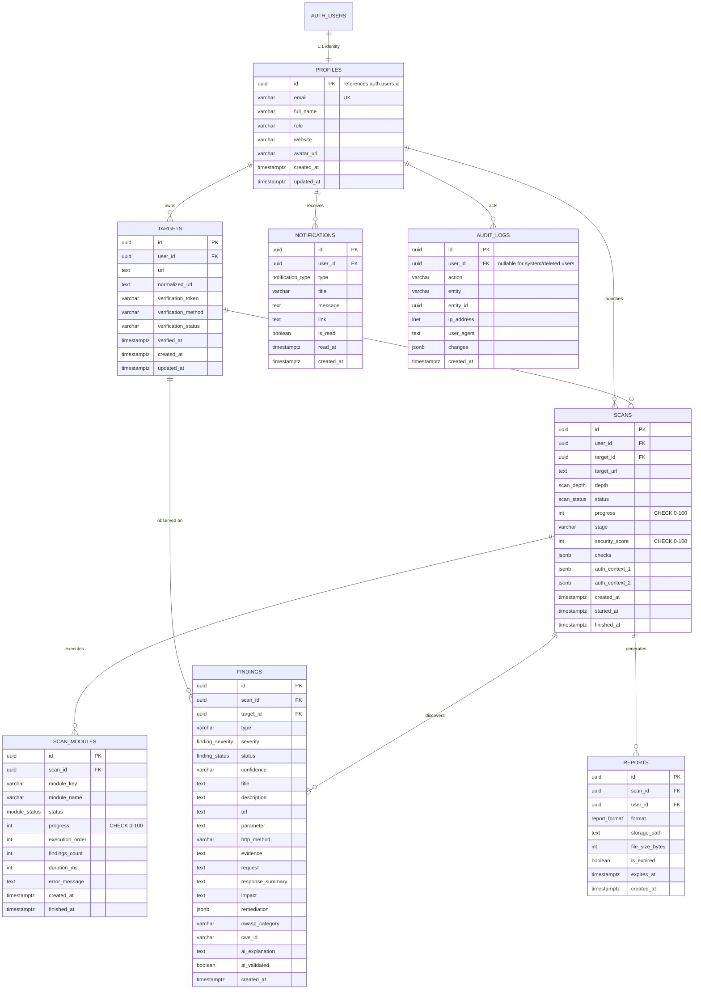

# EthioSec Scanner - Entity Relationship Architecture

## 1. Relational Entity Diagram

## 2. Table Cardinality & Foreign Key Justifications

| Parent Table | Child Table | Foreign Key Column | Action | Justification |
| :--- | :--- | :--- | :--- | :--- |
| `auth.users` | `profiles` | `profiles.id` | **`ON DELETE CASCADE`** | When an identity is deleted in Supabase Auth, its application profile has no legal basis to persist. |
| `profiles` | `targets` | `targets.user_id` | **`ON DELETE CASCADE`** | Targets registered by a user must be purged when the user account is closed. |
| `profiles` | `scans` | `scans.user_id` | **`ON DELETE CASCADE`** | User scan history belongs strictly to the tenant account. |
| `targets` | `scans` | `scans.target_id` | **`ON DELETE SET NULL`** | **Critical Security Decision:** If a user deletes a configured target from their dashboard, past scan results, compliance records, and vulnerability timelines **must not be deleted**. The `target_id` becomes `NULL`, preserving the immutable `target_url` already captured directly on the scan. |
| `scans` | `scan_modules`| `scan_modules.scan_id`| **`ON DELETE CASCADE`** | Pipeline stages are ephemeral execution tracking state for that specific scan run. |
| `scans` | `findings` | `findings.scan_id` | **`ON DELETE CASCADE`** | Findings are direct diagnostic children of a scan run. Deleting a scan purges its findings. |
| `targets` | `findings` | `findings.target_id` | **`ON DELETE SET NULL`** | Deleting a target retains the finding associated with the historical scan run. |
| `scans` | `reports` | `reports.scan_id` | **`ON DELETE CASCADE`** | Generated reports are derived artifacts of the parent scan. |
| `profiles` | `notifications` | `notifications.user_id` | **`ON DELETE CASCADE`** | Personal alerts must be purged upon user account deletion. |
| `profiles` | `audit_logs` | `audit_logs.user_id` | **`ON DELETE SET NULL`** | **SOC2 / ISO 27001 Compliance:** Audit logs **must never be deleted** when a user account is removed. Setting `user_id` to `NULL` while retaining the actor's email/IP snapshot in the `details` JSONB ensures non-repudiation. |
