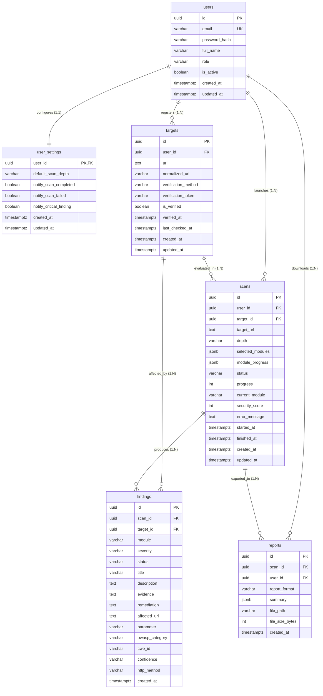

# EthioSec Scanner - Database Diagram & Architecture

This document describes the relational database structure, entity relationships, and table designs for EthioSec Scanner.

---

## 1. Entity-Relationship Diagram

---

## 2. Table Descriptions in Plain Language

### 1. `users`
* **Purpose**: Manages user accounts and credentials.
* **Key fields**: `id` (UUID), `email` (unique, lowercase), `password_hash` (bcrypt hash string), `role` (`'user'` or `'admin'`), and `is_active` (boolean flag to prevent inactive user logins).
* **Cascade**: Deleting a user cascades and permanently removes all related settings, targets, scans, findings, and reports.

### 2. `user_settings`
* **Purpose**: Stores individual scanner preferences in a dedicated 1:1 table.
* **Key fields**: `user_id` (acts as both Primary Key and Foreign Key linking to `users.id`), `default_scan_depth` (`'quick'`, `'standard'`, or `'deep'`), and notification preference booleans.
* **Design reason**: Keeps account authentication clean and separate from display and notification settings.

### 3. `targets`
* **Purpose**: Represents website URLs registered by users for vulnerability assessments.
* **Key fields**: `url`, `normalized_url`, `verification_method` (`'dns_txt'`, `'meta_tag'`, or `'http_file'`), `verification_token` (random security challenge), and `is_verified`.
* **Security constraint**: A unique constraint on `(user_id, normalized_url)` prevents adding duplicate entries for the same target under one account. A scan cannot be launched against an unverified target.

### 4. `scans`
* **Purpose**: Tracks individual security audit runs against a verified target.
* **Key fields**:
  * `target_url`: Snapshot of the target address at scan launch time.
  * `depth`: Depth profile (`'quick'`, `'standard'`, `'deep'`).
  * `selected_modules`: JSONB array of active check modules.
  * `module_progress`: Change-tracked JSONB dictionary containing per-module state (`checks_run`, `checks_passed`, `findings_count`, `status`, and `error`).
  * `progress`: Integer from 0 to 100.
  * `security_score`: Calculated rating from 0 to 100.
  * `status`: Job state (`'queued'`, `'running'`, `'completed'`, `'failed'`, `'cancelled'`).

### 5. `findings`
* **Purpose**: Records individual security weaknesses discovered during a scan.
* **Key fields**:
  * `severity`: Strict CHECK constraint enforcing `'critical'`, `'high'`, `'medium'`, `'low'`, or `'info'`.
  * `status`: Finding triage status (`'open'`, `'confirmed'`, `'false_positive'`, `'resolved'`).
  * `module`: One of the 11 vulnerability modules (`'sqli'`, `'xss'`, `'headers'`, `'https'`, `'cookies'`, `'cors'`, `'http_methods'`, `'info_disclosure'`, `'exposed_files'`, `'access_control'`, `'auth_checks'`).
  * `title`, `description`, `evidence`, `remediation`, and `affected_url`.
* **Design reason**: Linking `target_id` directly in addition to `scan_id` allows instant retrieval of all historical issues on a target without expensive multi-table joins.

### 6. `reports`
* **Purpose**: Stores generated report snapshots and export records.
* **Key fields**: `scan_id`, `user_id`, `report_format` (`'pdf'`, `'html'`, `'json'`), and a `summary` JSONB snapshot containing the score and severity breakdown.
* **Design reason**: `file_path` and `file_size_bytes` are nullable because reports can be generated on-demand directly from the database without requiring disk file caching.

---

## 3. Defense Rationale for Graduation

1. **Why Python-side `uuid.uuid4` instead of database `gen_random_uuid()`?**
   * Eliminates database vendor locks and ensures identical, portable UUID generation across local developer PostgreSQL servers and unit test environments.
2. **Why `VARCHAR` + SQL `CHECK` constraints instead of PostgreSQL ENUM types?**
   * Adding new values to native PostgreSQL ENUMs requires restrictive schema locks. `CHECK` constraints derived from `vocabulary.py` provide identical data integrity while keeping migrations clean.
3. **How are Passed Checks and Scanner Errors calculated?**
   * The `findings` table strictly records vulnerabilities. The `scans.module_progress` telemetry structure records `checks_passed` and `error` messages per module, keeping the data model normalized and efficient.
